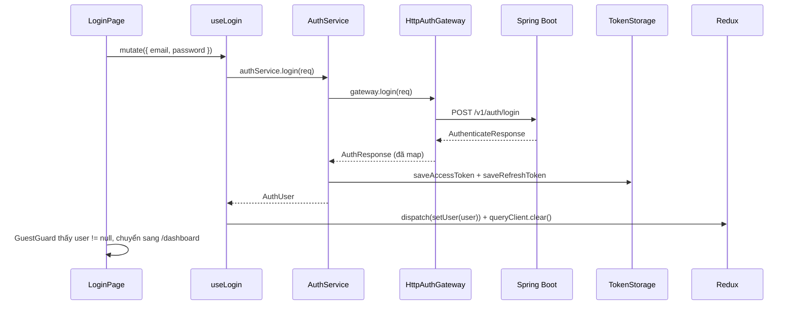
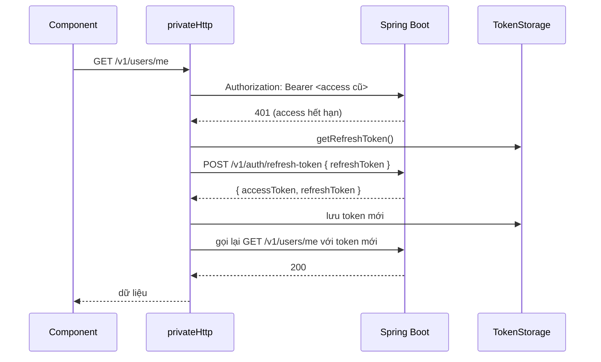
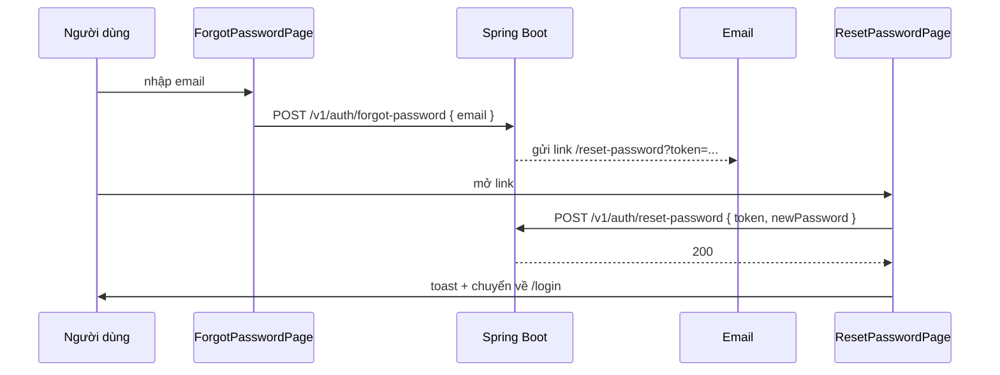

# TutorLink – Hướng dẫn gọi API theo flow Auth

Tài liệu này mô tả cách gọi API xác thực trong project (React + Vite + Redux + React Query + Axios), viết dựa trên code trong `src/`. Base URL lấy từ `VITE_API_BASE_URL`, mọi endpoint auth có prefix `/v1/auth`.

---

## 1. Tổng quan kiến trúc

```
Page (LoginPage, RegisterStudentPage, ...)
  └─ Hook (features/auth/hooks/useAuth.ts)         React Query useMutation + dispatch Redux
       └─ AuthService (features/auth/service)       use-case: gọi gateway + lưu/xoá token
            ├─ HttpAuthGateway (features/auth/api)  gọi HTTP, map DTO -> model FE
            │    └─ AxiosHttpClient(publicHttp)     axios KHÔNG gắn token
            └─ SecureTokenStorage (config/storage)  lưu access_token / refresh_token
```

Mọi object được khởi tạo một chỗ trong `config/di/container.ts`:

| Biến | Vai trò |
|---|---|
| `tokenStorage` | `SecureTokenStorage` (web dùng `localStorage`, key `access_token` / `refresh_token`) |
| `publicHttp` | axios cho endpoint công khai, không gắn token |
| `privateHttp` | axios cho endpoint cần đăng nhập, tự gắn `Authorization: Bearer ...` và tự refresh khi 401 |
| `authService` | `new AuthService(HttpAuthGateway(publicHttp), tokenStorage)` |

Toàn bộ `/v1/auth/**` đi qua **publicHttp**, vì token nằm trong body hoặc người dùng chưa đăng nhập.

> Cờ `env.features.auth = false` nghĩa là auth dùng **API thật**. Các feature khác (`user`, `tutor`, ...) đang `true` = mock.

---

## 2. Định dạng response chung

BE bọc kết quả trong envelope:

```json
{ "code": 1000, "message": "Success", "data": { } }
```

Cả `publicClient` và `privateClient` có interceptor tự **bóc `data`** khi thấy đủ 3 key `code`, `data`, `message`. Vì vậy trong code FE, `AxiosHttpClient.post<T>()` trả thẳng `T` (phần `data`), không cần `res.data.data`.

Khi lỗi, `toApiError()` lấy thông báo theo thứ tự `data.message` → `data.detail` → `data.error` → `error.message`, rồi ném `ApiError(message, status)`. Ở UI dùng `getErrorMessage(error)` để hiển thị.

---

## 3. Bảng endpoint

| # | Chức năng | Method + Path | Client | Body | Response `data` |
|---|---|---|---|---|---|
| 1 | Đăng ký học viên | `POST /v1/auth/register/student` | public | `RegisterStudentRequest` | `AuthenticateResponse` |
| 2 | Đăng ký gia sư | `POST /v1/auth/register/tutor` | public | `RegisterTutorRequest` | `AuthenticateResponse` |
| 3 | Đăng nhập | `POST /v1/auth/login` | public | `LoginRequest` | `AuthenticateResponse` |
| 4 | Làm mới token | `POST /v1/auth/refresh-token` | axios thuần | `RefreshTokenRequest` | `AuthenticateResponse` |
| 5 | Đăng xuất | `POST /v1/auth/logout` | public | `LogoutRequest` | rỗng |
| 6 | Kiểm tra token | `POST /v1/auth/introspect` | public | `IntrospectRequest` | `IntrospectResponse` |
| 7 | Quên mật khẩu | `POST /v1/auth/forgot-password` | public | `ForgotPasswordRequest` | rỗng |
| 8 | Đặt lại mật khẩu | `POST /v1/auth/reset-password` | public | `ResetPasswordRequest` | rỗng |
| 9 | Lấy user hiện tại | `GET /v1/users/me` | private | – | user (hiện đang mock) |

---

## 4. Flow chi tiết từng bước

### 4.1 Đăng nhập



**Request**

```http
POST /v1/auth/login
Content-Type: application/json

{ "email": "student33@tutorlink.com", "password": "Student@123" }
```

**Response `data`** (`AuthenticateResponse`)

```json
{
  "accessToken": "eyJhbGciOi...",
  "refreshToken": "eyJhbGciOi...",
  "tokenType": "Bearer",
  "expiresIn": 3600,
  "user": {
    "id": "uuid",
    "fullName": "Nguyễn Văn A",
    "email": "student33@tutorlink.com",
    "phone": "0901234567",
    "gender": "MALE",
    "dateOfBirth": "2005-05-15",
    "address": { "street": "15 Võ Văn Ngân", "ward": "Phường Linh Chiểu", "province": "TP. Hồ Chí Minh" },
    "userStatus": "ACTIVE",
    "role": "ROLE_STUDENT"
  }
}
```

`toAuthResponse()` chuẩn hoá `role` (bỏ tiền tố `ROLE_`, ép về `STUDENT | TUTOR | ADMIN`) và điền mặc định cho field thiếu (`gender` → `OTHER`, `dateOfBirth` → `""`).

**Cách dùng trong component**

```tsx
const login = useLogin();
login.mutate({ email, password });

login.isPending   // đang gọi
login.isError     // lỗi -> getErrorMessage(login.error)
```

### 4.2 Đăng ký

Hai trang riêng, hai endpoint riêng. Sau khi đăng ký thành công BE trả luôn token như login, nên FE **tự đăng nhập luôn** (`startSession`).

**Học viên** – `POST /v1/auth/register/student`

```json
{
  "fullName": "Nguyễn Văn A",
  "email": "student33@tutorlink.com",
  "password": "Student@123",
  "phone": "0901234567",
  "gender": "MALE",
  "dateOfBirth": "2005-05-15",
  "address": { "street": "15 Võ Văn Ngân", "ward": "Phường Linh Chiểu", "province": "TP. Hồ Chí Minh" },
  "grade": "12",
  "learningGoal": "Cải thiện kỹ năng lập trình"
}
```

**Gia sư** – `POST /v1/auth/register/tutor`

```json
{
  "fullName": "Nguyễn Văn Tutor",
  "email": "tutors32@tutorlink.com",
  "password": "Tutor@123",
  "phone": "0912345678",
  "gender": "MALE",
  "dateOfBirth": "1998-03-20",
  "address": { "street": "12 Nguyễn Huệ", "ward": "Phường Bến Nghé", "province": "TP. Hồ Chí Minh" },
  "experienceYears": 5,
  "education": "Đại học Bách Khoa TP.HCM",
  "subjectIds": ["01a0eb0f-d346-75b2-9dee-7524cb5a1466"]
}
```

Gọi từ UI:

```tsx
const registerMutation = useRegister("STUDENT"); // hoặc "TUTOR"
registerMutation.mutate(payload, {
  onSuccess: () => navigate(ROUTES.DASHBOARD, { replace: true }),
});
```

Có thể dùng `useRegisterStudent()` / `useRegisterTutor()` thay cho `useRegister(role)`, hai cách tương đương.

Sau đăng ký gia sư, trang chuyển sang `ROUTES.TUTOR_PROFILE` và hiện toast "Hồ sơ đang chờ Admin duyệt".

### 4.3 Gọi API cần đăng nhập (và tự refresh token)

Dùng `privateHttp` (import `http` từ `@/config/axiosClient`). Interceptor làm 3 việc:

1. **Request:** đọc `access_token` từ storage, gắn `Authorization: Bearer <token>`.
2. **Response:** bóc envelope `{code, message, data}`.
3. **Lỗi 401:** thử refresh đúng một lần rồi gọi lại request cũ.



Chi tiết cần nhớ:

- Nhiều request cùng 401 thì chỉ refresh **một lần**, các request còn lại chờ chung (`refreshing` promise).
- Request refresh dùng `axios` thuần, không đi qua interceptor, để tránh vòng lặp 401.
- Request đã retry được đánh dấu `_retry = true`, không retry lần hai.
- Refresh thất bại (hoặc không có refresh token): xoá token và phát `unauthorizedEvent.emit()`.
- Lỗi 403 phát `forbiddenEvent.emit()`.

**Request refresh**

```http
POST /v1/auth/refresh-token
{ "refreshToken": "eyJhbGciOi..." }
```

`AuthService` không gọi refresh trực tiếp, việc này do interceptor lo. `HttpAuthGateway.refreshToken()` có sẵn nếu cần gọi thủ công.

### 4.4 Đăng xuất

```tsx
const logout = useLogout();
logout.mutate();
```

Thứ tự trong `AuthService.logout()`:

1. Đọc `accessToken` và `refreshToken` từ storage.
2. Nếu có đủ cả hai: `POST /v1/auth/logout` với `{ accessToken, refreshToken }`.
3. `finally`: luôn `tokens.clear()`, kể cả khi API lỗi.

Hook dùng `onSettled` nên dù thành công hay lỗi đều `dispatch(clearUser())` và `queryClient.clear()`. Sau đó `AuthGuard` đưa người dùng về `/login`.

### 4.5 Quên mật khẩu và đặt lại mật khẩu



```http
POST /v1/auth/forgot-password
{ "email": "student33@tutorlink.com" }

POST /v1/auth/reset-password
{ "token": "<lấy từ query ?token=>", "newPassword": "NewPass@123" }
```

Hook có sẵn: `useForgotPassword()`, `useResetPassword()`.

### 4.5b Introspect (kiểm tra token)

```http
POST /v1/auth/introspect
{ "accessToken": "eyJhbGciOi..." }
```

```json
{ "active": true, "scope": "ROLE_STUDENT", "userId": "uuid", "sub": "student33@tutorlink.com", "exp": 1767000000, "iat": 1766996400 }
```

`useIntrospect()` trả `null` nếu không có access token trong storage. Hiện chưa có chỗ nào trong app gọi hook này.

### 4.6 Khôi phục phiên khi tải lại trang

`AuthInitializer` bọc `RouterProvider` trong `main.tsx`: nếu còn token thì gọi `userService.getMe()` (`GET /v1/users/me`), `dispatch(setUser(user))`, rồi mới render router để guard không đá người dùng về `/login` oan. Xem **mục 6, vấn đề 1**, vì hiện phần này đang đọc sai chỗ lưu token.

### 4.7 Guard và phân quyền

| Guard | Điều kiện | Khi không thoả |
|---|---|---|
| `GuestGuard` | `auth.user === null` | chuyển `/dashboard` |
| `AuthGuard` | `auth.user !== null` | chuyển `/login` (kèm `state.from`) |
| `RoleGuard allow=[...]` | `ADMIN` luôn qua, còn lại phải nằm trong `allow` | chuyển `/dashboard` |

Trạng thái đăng nhập của guard dựa hoàn toàn vào **Redux `auth.user`**, không phải vào việc có token hay không.

---

## 5. Tóm tắt kiểu dữ liệu

```ts
// Request (auth.dto.ts)
LoginRequest           { email, password }
RefreshTokenRequest    { refreshToken }
LogoutRequest          { accessToken, refreshToken }
IntrospectRequest      { accessToken }
ForgotPasswordRequest  { email }
ResetPasswordRequest   { token, newPassword }
RegisterStudentRequest { fullName, email, password, phone?, gender?, dateOfBirth?, address, grade?, learningGoal? }
RegisterTutorRequest   { fullName, email, password, phone?, gender?, dateOfBirth?, address, experienceYears, education?, subjectIds[] }

// Response
AuthenticateResponse   { accessToken, refreshToken, tokenType, expiresIn?, user: BaseUserResponse }

// Model FE sau khi map (auth.types.ts)
AuthTokens   { accessToken, refreshToken }
AuthResponse extends AuthTokens { user: AuthUser }
```

`AddressRequest`: `{ street: string, ward?: string, province: string }`.
`Role`: `STUDENT | TUTOR | ADMIN`. `Gender`: `MALE | FEMALE | OTHER`.

---

## 6. Vấn đề phát hiện trong code hiện tại

Mình đọc code và thấy các điểm sau, nên xử lý trước khi test flow đầy đủ.

1. **Khôi phục phiên sau khi reload không hoạt động.** `AuthInitializer` (và `mocks/session.ts`, `chatbot.service.ts`) import `features/auth/store/tokenStorage` với key `tl_access` / `tl_refresh`, trong khi `AuthService` lưu token bằng `SecureTokenStorage` với key `access_token` / `refresh_token`. Hai nơi không nhìn thấy nhau, nên sau khi reload `ready = true` ngay, `user = null`, và `AuthGuard` đưa về `/login` dù token còn. Cách sửa: cho `AuthInitializer` dùng `tokenStorage` từ `@/config/di/container` (bất đồng bộ, cần `await getAccessToken()`), và xoá file `store/tokenStorage.ts` cũ.
2. **`unauthorizedEvent` chưa có ai lắng nghe.** Khi refresh thất bại, token bị xoá nhưng Redux vẫn giữ `user`, nên giao diện vẫn "đang đăng nhập". Cần đăng ký ở nơi khởi tạo app, ví dụ `unauthorizedEvent.on(() => { store.dispatch(clearUser()); queryClient.clear(); })`. `sessionEvents.ts` là kênh cũ trùng chức năng, nên bỏ một trong hai.
3. **`getMe()` chưa map DTO.** Với `features.user = false`, `userService.getMe()` trả thẳng `BaseUserResponse` từ BE (role có thể là `ROLE_STUDENT`), trong khi login đã đi qua `toAuthUser`. Nên dùng `toAuthUser(dto)` để hai đường cho cùng một dạng.
4. **`changePassword` gọi nhầm endpoint.** `userService.changePassword` gửi `{ currentPassword, newPassword }` tới `/v1/auth/reset-password`, nhưng endpoint này nhận `{ token, newPassword }`. Cần endpoint đổi mật khẩu riêng cho người đã đăng nhập.
5. **`ResetPasswordPage` dùng `http` (privateHttp)** thay vì `authService.resetPassword`. Nó gắn Bearer token không cần thiết và dính logic 401/refresh. Nên đổi sang `useResetPassword()` như các endpoint auth khác.
6. **Log nhạy cảm.** `HttpAuthGateway.login` có `console.log(res)` (in cả token), và interceptor in `JSON.stringify(config.data)` (in cả mật khẩu và refresh token). Nên xoá, hoặc chỉ bật khi `import.meta.env.DEV` và che các field `password`, `token`.
7. **Hai hook đăng ký trùng nhau.** `useRegister(role)` lặp lại logic của `useRegisterStudent` / `useRegisterTutor` (và ép kiểu `as`). Có thể bỏ `useRegister` để tránh cast.
8. **Gia sư vừa đăng ký có thể chưa được duyệt.** BE trả token ngay, nhưng `userStatus` có thể là `PENDING_VERIFICATION`. Nếu BE chặn một số API với trạng thái này, FE sẽ nhận 403 và `forbiddenEvent` cũng chưa có listener.
9. **`toRole` ném lỗi với role lạ**, khiến cả đăng nhập thất bại thay vì báo lỗi rõ ràng. Cân nhắc bắt lỗi ở gateway và trả thông báo thân thiện.
10. **Lưu token trong `localStorage`.** Dễ bị đọc nếu có XSS. Nếu cần an toàn hơn, giữ access token trong bộ nhớ và để BE set refresh token qua cookie `HttpOnly; Secure; SameSite`.

---

## 7. Cách test nhanh bằng curl

```bash
BASE=http://localhost:8080   # thay bằng VITE_API_BASE_URL

# Đăng ký học viên
curl -X POST $BASE/v1/auth/register/student -H "Content-Type: application/json" -d '{
  "fullName":"Nguyễn Văn A","email":"student33@tutorlink.com","password":"Student@123",
  "phone":"0901234567","gender":"MALE","dateOfBirth":"2005-05-15",
  "address":{"street":"15 Võ Văn Ngân","ward":"Phường Linh Chiểu","province":"TP. Hồ Chí Minh"},
  "grade":"12","learningGoal":"Cải thiện kỹ năng lập trình"}'

# Đăng nhập
curl -X POST $BASE/v1/auth/login -H "Content-Type: application/json" \
  -d '{"email":"student33@tutorlink.com","password":"Student@123"}'

# Làm mới token
curl -X POST $BASE/v1/auth/refresh-token -H "Content-Type: application/json" \
  -d '{"refreshToken":"<REFRESH>"}'

# Gọi API có token
curl $BASE/v1/users/me -H "Authorization: Bearer <ACCESS>"

# Đăng xuất
curl -X POST $BASE/v1/auth/logout -H "Content-Type: application/json" \
  -d '{"accessToken":"<ACCESS>","refreshToken":"<REFRESH>"}'
```

---

## 8. Danh sách file liên quan

| Lớp | File |
|---|---|
| Cấu hình / DI | `config/di/container.ts`, `config/env.ts` |
| HTTP | `config/http/publicClient.ts`, `config/http/privateClient.ts`, `config/AxiosHttpClient.ts`, `config/http/apiError.ts`, `config/events/emitter.ts` |
| Storage | `config/storage/types.ts`, `config/storage/SecureTokenStorage.web.ts` |
| Gateway | `features/auth/api/auth.gateway.ts`, `features/auth/api/http.auth.gateway.ts` |
| Service / Hook | `features/auth/service/auth.service.ts`, `features/auth/hooks/useAuth.ts` |
| DTO / Mapper | `features/auth/types/auth.dto.ts`, `features/auth/types/auth.types.ts`, `features/auth/mappers/auth.mapper.ts` |
| State | `features/auth/store/authSlice.ts`, `app/store.ts` |
| UI | `pages/LoginPage.tsx`, `pages/RegisterStudentPage.tsx`, `pages/RegisterTutorPage.tsx`, `pages/ForgotPasswordPage.tsx`, `pages/ResetPasswordPage.tsx` |
| Bảo vệ route | `shared/components/guards/{AuthGuard,GuestGuard,RoleGuard}.tsx`, `features/auth/components/AuthInitializer.tsx`, `app/router.tsx` |